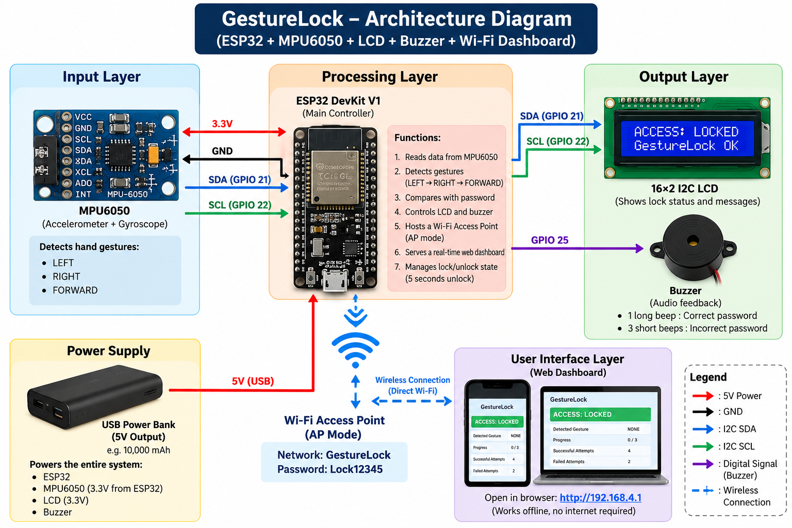
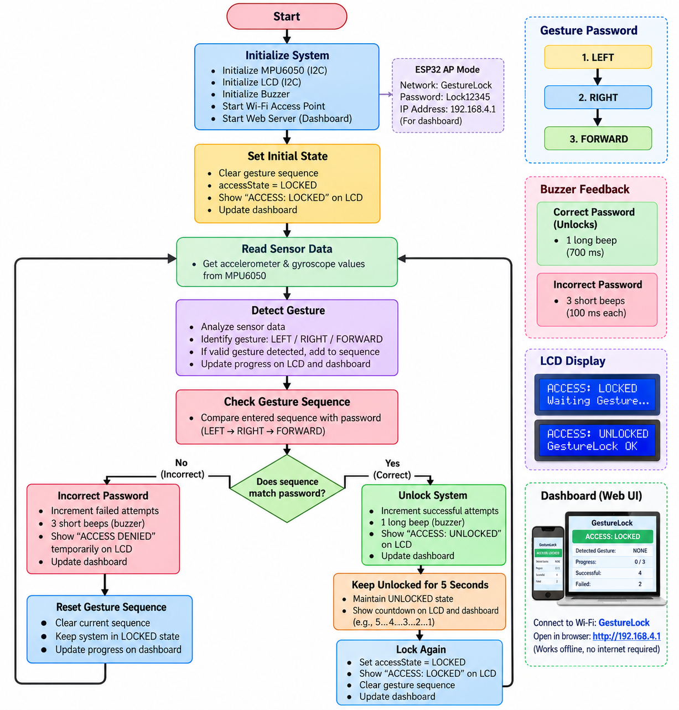

# GestureLock : IoT Based Gesture Password And Authentication System 🔐

**An offline gesture-based smart lock prototype built with ESP32, MPU6050, a 16×2 I²C LCD, and a buzzer.**

GestureLock uses a hand-motion sequence as a gesture password. The ESP32 hosts its own Wi-Fi access point and a local web dashboard, so you can monitor the lock from a phone or laptop **without a router or internet connection**.

> **Project status:** Prototype / educational project. The firmware and hardware must be tested together before relying on it. This is not a certified security lock.

## Features

- Gesture password: **LEFT → RIGHT → FORWARD**
- ESP32 DevKit V1 as the main controller
- MPU6050 accelerometer/gyroscope for motion input
- 16×2 I²C LCD for local status messages
- Buzzer feedback:
  - Correct sequence: one long beep
  - Incorrect sequence: three short beeps
- Local Wi-Fi access point (AP) mode
- Browser dashboard with status, detected gesture, progress, and attempt counters
- Automatic relocking after the configured 5-second unlock period
- Portable operation from a suitable USB power bank

## Architecture



## Flowchart



## Hardware

| Component | Purpose |
|---|---|
| ESP32 DevKit V1 | Reads sensor data, validates the gesture sequence, drives outputs, hosts Wi-Fi and the web server |
| MPU6050 | Accelerometer and gyroscope used to infer hand gestures |
| 16×2 LCD with I²C backpack | Displays lock state and feedback |
| Buzzer | Audio feedback for success/failure |
| USB power bank / regulated USB supply | Portable power for the ESP32 and connected modules |
| Jumper wires and breadboard | Connections |

## Wiring

The pin assignments below match the supplied sketch. Verify your specific modules before powering the circuit.

| Module pin | ESP32 connection |
|---|---|
| MPU6050 VCC | 3V3 |
| MPU6050 GND | GND |
| MPU6050 SDA | GPIO 21 |
| MPU6050 SCL | GPIO 22 |
| I²C LCD SDA | GPIO 21 |
| I²C LCD SCL | GPIO 22 |
| LCD GND | GND |
| LCD VCC | **Use a voltage compatible with your LCD backpack and ESP32 I²C logic** |
| Buzzer signal / + (as applicable) | GPIO 25 |
| Buzzer GND / − | GND |
| ESP32 USB | USB power bank or computer USB during upload |

### Important I²C voltage note

The MPU6050 and LCD share the ESP32 I²C bus on GPIO 21 (SDA) and GPIO 22 (SCL). Some LCD I²C backpacks pull SDA/SCL up to their supply voltage. **Do not assume a 5 V-powered backpack is safe for ESP32 GPIOs.** Check the backpack circuit/specification or use a suitable bidirectional I²C level shifter if the pull-ups are at 5 V. An I²C scan finding the LCD does not prove the bus voltage is safe.

For buzzer modules that draw more current than an ESP32 GPIO can safely provide, use an appropriate transistor driver and common ground rather than powering the buzzer directly from the pin.

## Software requirements

- Arduino IDE 2.x (or a compatible Arduino IDE)
- ESP32 board support installed through Boards Manager
- `LiquidCrystal_I2C` library — the project was written for the commonly used **Frank de Brabander** library
- ESP32 board selected in Arduino IDE (for example, **ESP32 Dev Module**)

The sketch uses direct I²C register access for the MPU6050, so a separate Adafruit MPU6050 library is not required.

## Quick start

1. Download or clone this repository.
2. Open `src/GestureLock/GestureLock.ino` in Arduino IDE.
3. Install ESP32 board support and the `LiquidCrystal_I2C` library if not already installed.
4. Connect the ESP32 to your computer over USB.
5. Select the correct ESP32 board and COM port.
6. Upload the sketch.
7. Open Serial Monitor at the baud rate configured in the sketch to inspect startup messages.
8. Power the board and wait for the access point to start.
9. On your phone/laptop, connect to the Wi-Fi network:
   - **SSID:** `GestureLock`
   - **Password:** `Lock12345`
10. Open **http://192.168.4.1** in a browser.

The hotspot is local-only. Your phone may warn that this Wi-Fi has no internet; stay connected to use the dashboard. After uploading, the project can run from a suitable USB power bank without leaving the laptop connected.

## Using the gesture password

Perform the configured sequence with the MPU6050 mounted securely:

1. LEFT
2. RIGHT
3. FORWARD

The sensor's orientation, mounting, and movement thresholds affect recognition. If gestures are missed or misclassified, tune the thresholds and timing in the sketch and test repeatedly under consistent conditions.

## Dashboard

The dashboard is served by the ESP32 itself. It polls the local `/status` endpoint and updates without requiring a full-page refresh. It is available only to devices connected to the GestureLock access point.

## Configuration

The current sketch contains the AP name/password, I²C addresses, pin assignments, gesture logic, and unlock duration. Search the sketch for the relevant constants before changing them.

| Setting | Current value |
|---|---|
| Wi-Fi SSID | `GestureLock` |
| Wi-Fi password | `Lock12345` |
| Dashboard URL | `http://192.168.4.1` |
| MPU6050 I²C address | `0x68` (common default) |
| LCD I²C address | `0x27` (confirmed for the current setup) |
| I²C SDA / SCL | GPIO 21 / GPIO 22 |
| Buzzer pin | GPIO 25 |
| Unlock duration | 5 seconds |

Change the default AP password before sharing or demonstrating the project publicly. The dashboard uses local HTTP and is intended for a classroom prototype, not a hardened security product.

## Troubleshooting

### LCD lights up but shows no text
- Adjust the LCD backpack contrast potentiometer slowly.
- Confirm the LCD address (`0x27` for the current setup).
- Check SDA/SCL and common ground.
- Confirm the installed `LiquidCrystal_I2C` library matches the sketch.
- Check I²C voltage compatibility before changing the LCD supply.

### MPU6050 is not detected
- Confirm VCC is 3.3 V, GND is connected, SDA is GPIO 21, and SCL is GPIO 22.
- Check the sensor address (`0x68` is typical; AD0 may change it).
- Keep wires short and connections secure.

### Phone connects to Wi-Fi but dashboard does not open
- Make sure you are connected to `GestureLock`.
- Enter `http://192.168.4.1` explicitly, not HTTPS.
- Disable mobile data temporarily if the phone keeps switching away from the no-internet network.
- Restart the ESP32 and reconnect.

### Gestures are incorrect or inconsistent
- Secure the MPU6050 in a consistent orientation.
- Perform each movement distinctly and pause between movements.
- Adjust gesture thresholds/timing in the sketch for your mounting and use case.
- Test many times; sensor-based gesture recognition is sensitive to calibration and motion.

### Buzzer does not sound
- Verify polarity and the module's active-high/active-low behavior.
- Check GPIO 25 and common ground.
- Use a driver circuit if the buzzer's current exceeds safe GPIO limits.

## Repository structure

```text
GestureLock/
├── README.md
├── LICENSE
├── CONTRIBUTING.md
├── SECURITY.md
├── .gitignore
├── src/
│   └── GestureLock/
│       └── GestureLock.ino
├── assets/
│   ├── architecture-diagram.png
│   └── flowchart.png
└── docs/
    ├── WIRING.md
    ├── TESTING.md
    └── PROJECT-OVERVIEW.md
```

## Testing checklist

- [ ] ESP32 boots and initializes the MPU6050.
- [ ] LCD displays the initial locked state.
- [ ] Gesture progress updates as expected.
- [ ] Correct sequence unlocks the prototype.
- [ ] Incorrect sequence is rejected and produces the expected buzzer feedback.
- [ ] System returns to locked state after the unlock period.
- [ ] AP is visible and a phone can connect.
- [ ] Dashboard opens at `http://192.168.4.1` and status updates.
- [ ] System runs from a power bank after USB upload.
- [ ] LCD I²C voltage levels and buzzer drive are electrically safe.

## Limitations and safety

- Gesture recognition depends on sensor orientation, movement thresholds, and calibration.
- The AP password and local HTTP dashboard are prototype-level, not production security.
- This project does not replace a certified lock or access-control system.
- Do not use the prototype to protect valuables or safety-critical access.
- Check all module voltage and current requirements before powering the circuit.

## Contributing

Bug reports, documentation improvements, wiring corrections, and tested enhancements are welcome. See [CONTRIBUTING.md](CONTRIBUTING.md).

## License

Released under the MIT License. See [LICENSE](LICENSE).

## Acknowledgements

Built as an educational embedded-systems and IoT project using the ESP32 and MPU6050 ecosystem.
