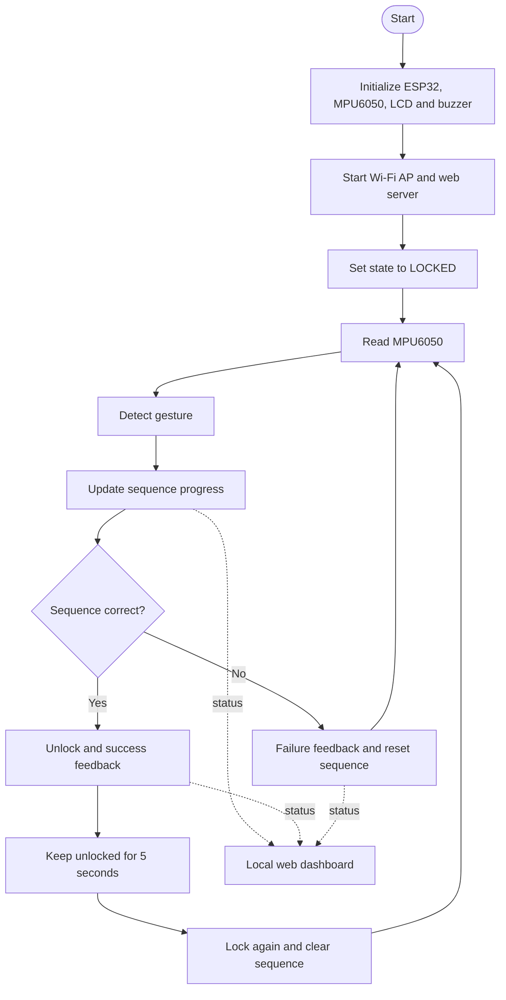

# Project Overview

## Objective
Build a portable gesture-controlled lock prototype that validates a predefined hand-motion sequence and reports status locally.

## Functional blocks
1. **Sensing:** MPU6050 measures acceleration and angular motion.
2. **Controller:** ESP32 reads sensor values and classifies gestures using the sketch's logic.
3. **Sequence validation:** Recognized gestures are compared with `LEFT → RIGHT → FORWARD`.
4. **Feedback:** LCD communicates state; buzzer signals success or failure.
5. **Local monitoring:** ESP32 runs an access point and web server for a browser dashboard.
6. **Power:** USB power bank can supply the ESP32 after firmware upload.

## Data flow

## Scope and limitations
This is an educational prototype. Sensor thresholds need real-world tuning and the local dashboard is not a hardened security interface. Do not rely on it as a production lock.
